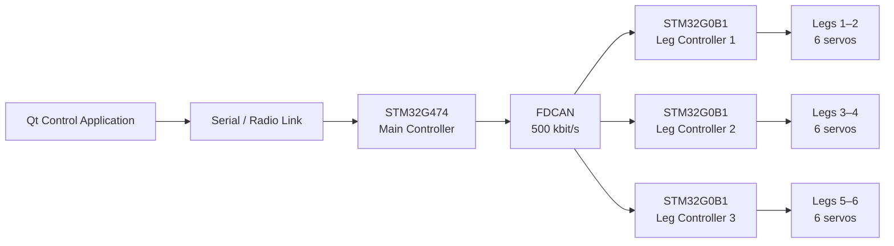

<table>
  <tr>
    <td><b>🇬🇧 English</b></td>
    <td><a href="./README_RU.md">🇷🇺 Русский</a></td>
  </tr>
</table>

# 🕷️ Hexapod — Distributed 18-DOF Robotic Platform

A six-legged robotic platform built around a distributed STM32 control architecture.

The project combines inverse kinematics, tripod gait generation, CAN-based distributed motor control, a custom communication protocol and a Qt desktop control application with real-time 3D visualization.

The main design goal is to keep high-level motion planning separated from low-level actuator control, allowing the platform to evolve toward autonomous locomotion, contact sensing and remote presence.

---

## ⚙️ System Architecture



### Control hierarchy

**Desktop application**
- Operator input
- WASD movement control
- Command packet generation
- Robot state reception
- Real-time 3D visualization

**STM32G474 — Brain**
- Inverse kinematics
- Foot trajectory generation
- Tripod gait state machine
- Motion command processing
- Per-leg angle generation
- Distribution of commands through FDCAN

**STM32G0B1 — Leg controllers**
- Each controller operates two legs
- Receives target joint angles through CAN
- Smoothly interpolates joint positions
- Generates PWM for six servo channels

---

## 🦿 Mechanical Model

The robot has **6 legs × 3 joints = 18 DOF**.

Each leg consists of:

| Segment | Length |
|---|---:|
| Coxa | 55 mm |
| Femur | 90 mm |
| Tibia | 140 mm |

Joint limits currently used by the firmware:

| Joint | Range |
|---|---:|
| Coxa | −45° … +45° |
| Femur | −90° … +90° |
| Tibia | −90° … +90° |

The mechanical model and robot geometry are maintained in FreeCAD and Blender.

---

## 🧠 Inverse Kinematics

The main controller works with Cartesian foot coordinates:

```text
(x, y, z) → (coxa, femur, tibia)
```

For every requested foot position the firmware:

1. Checks whether the point is inside the leg workspace.
2. Solves the three-joint inverse kinematics.
3. Verifies mechanical joint limits.
4. Converts the result into joint angles.
5. Sends the target angles to the corresponding leg controller.

Invalid or unreachable coordinates are rejected before commands are transmitted to the actuators.

The IK implementation runs directly on the STM32G474.

---

## 🚶 Locomotion

The current locomotion system uses an alternating **tripod gait**.

The six legs are divided into two groups:

```text
Tripod A: 3 legs
Tripod B: 3 legs
```

During a gait phase:

- one tripod performs the swing trajectory;
- the other tripod pushes against the ground;
- the active tripod is swapped after each half-cycle.

Foot motion is generated continuously rather than by jumping directly between servo positions.

The swing trajectory includes:

- horizontal interpolation;
- configurable step length;
- configurable step height;
- smooth lifting and lowering using `SmoothStep`;
- workspace validation through inverse kinematics.

Current gait parameters include:

```text
Step half-length: 45 mm
Step height:      35 mm
Gait update:      30 ms
Half-cycle:       500 ms
```

---

## 📡 Distributed CAN Control

Communication between the main controller and leg controllers uses **FDCAN at 500 kbit/s**.

The main controller sends compact 8-byte leg command frames containing:

```text
Leg ID
Coxa angle
Femur angle
Tibia angle
Checksum
```

Each leg controller knows which two legs it owns and ignores commands intended for the other controllers.

This separates:

```text
Motion planning
      ↓
Inverse kinematics
      ↓
CAN commands
      ↓
Local servo control
```

and prevents the central MCU from directly handling all 18 PWM channels.

---

## 🎛️ Leg Controllers

Each STM32G0B1 controller drives **six servo channels**, corresponding to two complete legs.

The controller performs local angle interpolation:

```text
Current angle → Target angle
```

instead of immediately applying a new target.

Current firmware updates joint motion every **10 ms** with configurable angular increments.

Servo calibration is handled independently for:

- Coxa
- Femur
- Tibia

including individual neutral pulse widths and positive/negative travel limits.

---

## 📻 PC ↔ Robot Protocol

The desktop controller communicates with the robot using a custom framed binary protocol.

Packet structure:

```text
0xAA 0x55 | Device ID | Command | Length | Payload | CRC16
```

Features:

- two-byte synchronization header;
- device addressing;
- command ID;
- variable payload size;
- CRC16 integrity checking;
- parser state machine on the STM32;
- communication timeout failsafe.

If control packets stop arriving, the robot automatically clears the active movement command.

---

## 🖥️ Qt Control Application

The repository contains a desktop control application written with **Qt/C++**.

Current functionality includes:

- keyboard control using `W`, `A`, `S`, `D`;
- command state transmission;
- base-position command;
- binary packet protocol;
- robot telemetry reception;
- real-time 3D model;
- visualization of individual coxa, femur and tibia angles.

The 3D representation uses Qt Quick / QML and receives actual joint state from the robot controller.

---

## 🔧 Firmware

The embedded firmware is written in C using CMSIS and custom low-level STM32 drivers.

Main peripherals used by the project:

- FDCAN
- USART
- TIM
- PWM
- SysTick
- GPIO

The project uses the same custom low-level driver library developed for the other STM32 projects:

[**STM32 Low-Level Drivers**](https://github.com/suneids/HAL_STM32F103C6T6)

---

## 📁 Repository Structure

```text
Hexapod/
├── 3d models/
│   ├── FreeCAD mechanical model
│   ├── Blender model
│   └── GLB model
│
├── app/
│   ├── desktop/
│   │   └── Hexapod/
│   │       ├── Qt/C++ control application
│   │       ├── communication protocol
│   │       ├── QML 3D visualization
│   │       └── robot model
│   │
│   └── firmware/
│       ├── Brain/
│       │   └── STM32G474 main controller
│       │
│       └── Leg/
│           └── STM32G0B1 leg controller
│
└── electronics/
    └── Hexapod/
        └── KiCad schematics
```

---

## 🚧 Current Status

### Implemented

- [x] 18-DOF mechanical model
- [x] Three-joint inverse kinematics
- [x] Cartesian foot positioning
- [x] Distributed STM32 architecture
- [x] FDCAN communication
- [x] Local servo control
- [x] Smooth joint interpolation
- [x] Forward tripod gait
- [x] Backward tripod gait
- [x] PC control protocol with CRC16
- [x] Communication timeout failsafe
- [x] Qt desktop controller
- [x] Real-time 3D joint visualization
- [x] KiCad electronics design

### In development

- [ ] Left/right locomotion
- [ ] Diagonal movement
- [ ] Foot contact sensing
- [ ] Gait adaptation using contact feedback
- [ ] Higher-level body translation and rotation
- [ ] Remote-presence functionality

---

## 🎯 Project Direction

The next stage is to move from purely kinematic locomotion toward **closed-loop interaction with the ground**.

Instead of assuming that every commanded foot trajectory was executed perfectly, each leg will eventually provide contact information back to the controller.

This allows the gait controller to react to the physical environment rather than operating only from predefined trajectories.

Long-term, the Hexapod is intended to serve as a platform for experimenting with:

- distributed robotic control;
- locomotion algorithms;
- contact-aware gait generation;
- embedded sensor fusion;
- remote presence;
- higher-level autonomous behavior.
