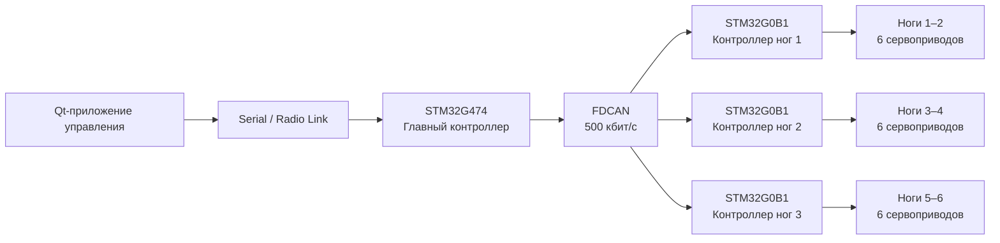

<table>
  <tr>
    <td><b>🇬🇧 English</b></td>
    <td><a href="./README_RU.md">🇷🇺 Русский</a></td>
  </tr>
</table>

# 🕷️ Hexapod — распределённая робототехническая платформа с 18 DOF

Шестиногая робототехническая платформа с распределённой архитектурой управления на STM32.

Проект объединяет обратную кинематику, генерацию tripod gait, распределённое управление приводами по CAN, собственный протокол связи и десктопное приложение на Qt с трёхмерной визуализацией состояния робота в реальном времени.

Основная идея архитектуры — разделить высокоуровневое управление движением и низкоуровневое управление приводами, чтобы платформа могла дальше развиваться в сторону автономного движения, датчиков контакта с поверхностью и remote presence.

---

## ⚙️ Архитектура системы



### Иерархия управления

**Десктопное приложение**
- Управление оператором
- Управление движением через WASD
- Формирование командных пакетов
- Приём состояния робота
- Трёхмерная визуализация в реальном времени

**STM32G474 — Brain**
- Обратная кинематика
- Генерация траекторий стоп
- State machine походки
- Обработка команд движения
- Расчёт углов суставов каждой ноги
- Передача команд контроллерам ног по FDCAN

**STM32G0B1 — контроллеры ног**
- Каждый контроллер управляет двумя ногами
- Принимает целевые углы суставов по CAN
- Плавно интерполирует положение суставов
- Формирует PWM для шести сервоприводов

---

## 🦿 Механическая модель

Робот имеет **6 ног × 3 сустава = 18 DOF**.

Каждая нога состоит из трёх звеньев:

| Звено | Длина |
|---|---:|
| Coxa | 55 мм |
| Femur | 90 мм |
| Tibia | 140 мм |

Ограничения суставов, используемые текущей прошивкой:

| Сустав | Диапазон |
|---|---:|
| Coxa | −45° … +45° |
| Femur | −90° … +90° |
| Tibia | −90° … +90° |

Механическая модель и геометрия робота разрабатываются в FreeCAD и Blender.

---

## 🧠 Обратная кинематика

Главный контроллер работает с декартовыми координатами стопы:

```text
(x, y, z) → (coxa, femur, tibia)
```

Для каждой требуемой позиции стопы прошивка:

1. Проверяет, находится ли точка внутри рабочей области ноги.
2. Решает задачу обратной кинематики для трёх суставов.
3. Проверяет механические ограничения суставов.
4. Преобразует результат в углы приводов.
5. Передаёт рассчитанные углы соответствующему контроллеру ноги.

Недостижимые координаты отбрасываются до отправки команд на приводы.

Расчёт IK выполняется непосредственно на STM32G474.

---

## 🚶 Локомоция

Текущая система движения использует чередующуюся **tripod gait**.

Шесть ног разделены на две группы:

```text
Tripod A: 3 ноги
Tripod B: 3 ноги
```

Во время одной фазы походки:

- одна тройка ног выполняет перенос;
- вторая тройка отталкивается от поверхности;
- после завершения половины цикла группы меняются ролями.

Траектория стопы формируется непрерывно, а не набором резких переходов между фиксированными положениями сервоприводов.

Траектория переноса включает:

- горизонтальную интерполяцию;
- настраиваемую длину шага;
- настраиваемую высоту подъёма;
- плавный подъём и опускание через `SmoothStep`;
- проверку рабочей области через обратную кинематику.

Текущие параметры походки:

```text
Полудлина шага:     45 мм
Высота шага:        35 мм
Период обновления:  30 мс
Полуцикл походки:   500 мс
```

---

## 📡 Распределённое управление по CAN

Связь между главным контроллером и контроллерами ног работает через **FDCAN на скорости 500 кбит/с**.

Главный контроллер передаёт компактные 8-байтовые команды:

```text
ID ноги
Угол Coxa
Угол Femur
Угол Tibia
Checksum
```

Каждый контроллер ног знает, за какие две ноги он отвечает, и игнорирует команды, предназначенные другим контроллерам.

Архитектура разделяет:

```text
Планирование движения
        ↓
Обратная кинематика
        ↓
Команды CAN
        ↓
Локальное управление сервоприводами
```

Благодаря этому центральному MCU не требуется напрямую обслуживать все 18 PWM-каналов.

---

## 🎛️ Контроллеры ног

Каждый STM32G0B1 управляет **шестью сервоприводами**, то есть двумя полноценными ногами.

Контроллер выполняет локальную интерполяцию:

```text
Текущий угол → Целевой угол
```

вместо мгновенной установки нового положения.

Текущая прошивка обновляет положение суставов каждые **10 мс** с настраиваемым шагом изменения угла.

Калибровка сервоприводов задаётся отдельно для:

- Coxa
- Femur
- Tibia

включая индивидуальные значения нейтрального PWM и пределы хода в положительном и отрицательном направлениях.

---

## 📻 Протокол PC ↔ Robot

Десктопное приложение связывается с роботом через собственный бинарный пакетный протокол.

Структура пакета:

```text
0xAA 0x55 | Device ID | Command | Length | Payload | CRC16
```

Реализованы:

- двухбайтовый заголовок синхронизации;
- адресация устройств;
- ID команды;
- переменный размер payload;
- контроль целостности через CRC16;
- state machine парсера на STM32;
- failsafe по таймауту связи.

Если управляющие пакеты перестают приходить, активная команда движения автоматически сбрасывается.

---

## 🖥️ Qt-приложение управления

В репозитории находится десктопное приложение на **Qt/C++**.

Текущий функционал:

- управление клавишами `W`, `A`, `S`, `D`;
- передача состояния команд движения;
- команда возврата в базовое положение;
- бинарный протокол связи;
- приём телеметрии робота;
- трёхмерная модель робота;
- визуализация углов Coxa, Femur и Tibia для каждой ноги.

3D-визуализация построена на Qt Quick / QML и обновляется по фактическому состоянию суставов, полученному от контроллера робота.

---

## 🔧 Прошивка

Embedded-прошивка написана на C с использованием CMSIS и собственных низкоуровневых драйверов STM32.

Основные используемые периферийные блоки:

- FDCAN
- USART
- TIM
- PWM
- SysTick
- GPIO

Проект использует ту же собственную библиотеку низкоуровневых STM32-драйверов, что и другие проекты:

[**STM32 Low-Level Drivers**](https://github.com/suneids/HAL_STM32F103C6T6)

---

## 📁 Структура репозитория

```text
Hexapod/
├── 3d models/
│   ├── механическая модель FreeCAD
│   ├── модель Blender
│   └── GLB-модель
│
├── app/
│   ├── desktop/
│   │   └── Hexapod/
│   │       ├── приложение управления Qt/C++
│   │       ├── протокол связи
│   │       ├── 3D-визуализация QML
│   │       └── модель робота
│   │
│   └── firmware/
│       ├── Brain/
│       │   └── главный контроллер STM32G474
│       │
│       └── Leg/
│           └── контроллер ног STM32G0B1
│
└── electronics/
    └── Hexapod/
        └── схемы KiCad
```

---

## 🚧 Текущее состояние

### Реализовано

- [x] Механическая модель с 18 DOF
- [x] Обратная кинематика трёхзвенной ноги
- [x] Позиционирование стопы в декартовых координатах
- [x] Распределённая архитектура на STM32
- [x] Связь по FDCAN
- [x] Локальное управление сервоприводами
- [x] Плавная интерполяция углов суставов
- [x] Tripod gait вперёд
- [x] Tripod gait назад
- [x] Протокол управления с CRC16
- [x] Failsafe по таймауту связи
- [x] Десктопное приложение на Qt
- [x] 3D-визуализация суставов в реальном времени
- [x] Проектирование электроники в KiCad

### В разработке

- [ ] Движение влево/вправо
- [ ] Диагональное движение
- [ ] Датчики контакта стоп с поверхностью
- [ ] Адаптация походки по обратной связи от датчиков контакта
- [ ] Управление положением и вращением корпуса
- [ ] Remote presence

---

## 🎯 Направление развития

Следующий этап проекта — переход от чисто кинематического движения к **замкнутому взаимодействию с поверхностью**.

Вместо предположения, что каждая заданная траектория стопы была выполнена идеально, каждая нога должна передавать контроллеру информацию о фактическом контакте с поверхностью.

Это позволит контроллеру походки реагировать на реальную среду, а не работать только по заранее рассчитанным траекториям.

В дальнейшем Hexapod должен стать платформой для экспериментов с:

- распределённым управлением роботами;
- алгоритмами локомоции;
- генерацией походки с учётом контакта;
- embedded sensor fusion;
- remote presence;
- более высокоуровневым автономным поведением.
